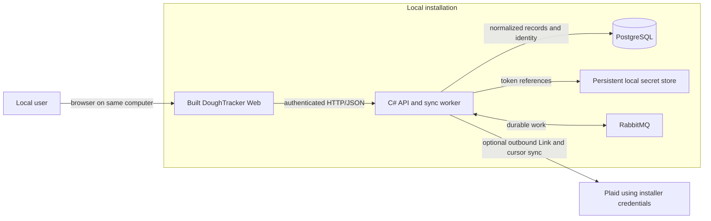
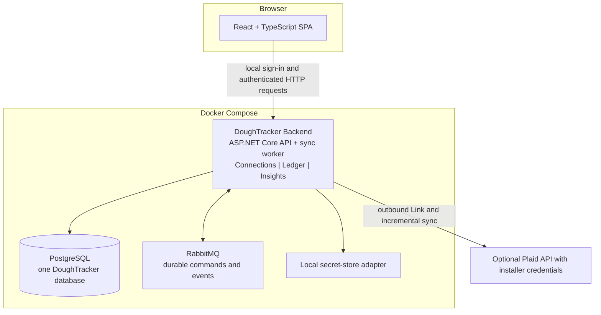
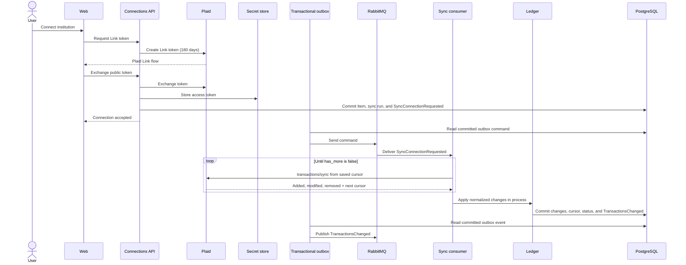

# DoughTracker Architecture Handoff

Status: Current destination for the local, open-source expense-report release

Last updated: 2026-10-17

The backend is being rebuilt from one API project under
[BACKEND-TASKS.md](BACKEND-TASKS.md). The boundaries and rules below remain the
approved destination, not a description of what the starter already implements.
Introduce projects and dependencies alongside the small behaviors that need them.

## 1. Purpose

DoughTracker is a free, open-source personal finance application that users
install and run on their own computer. It supports an individual's finances or
a financial picture a couple has chosen to combine. Its first release remains
an expense dashboard backed by stored checking, savings and credit-card data.
Budgets, investments, retirement projections, forecasts and net worth remain
later capabilities of this product.

A separate shared-expense product for cohabitants who keep finances separate
is outside this architecture and delivery plan. Do not add partner permissions,
contribution calculations, expense splitting or settlements to accommodate it.

The October 17 direction revises the existing rebuild's deployment, identity,
provider configuration and release requirements. It does not reset BR01/BR02 or
replace the financial model. This document defines the destination; the current
API still implements only the behavior recorded in its completed handoff.

## 2. Architectural goals

1. Store a trustworthy local ledger. Reports read stored data even when Plaid or
   the network is unavailable; cursor-based sync asks only what changed.
2. Keep provider-specific behavior out of Ledger and Insights.
3. Preserve the modular monolith, PostgreSQL and durable recovery boundaries;
   introduce dependencies alongside real use cases in small, understandable PRs.
4. Distribute a reproducible local Docker Compose application with no required
   cloud account for identity, maintainer server or paid runtime subscription.
5. Let installers supply their own Plaid credentials. The maintainer does not
   fund or proxy bank connections. Free live access depends on provider terms.
6. Treat installation, identity, persistent secrets, backups, restoration and
   upgrades as release behaviors, with public instructions shipped in the repo.

Local hosting means application data and services run on user-controlled hardware.
Plaid remains an external service and sees the data involved in bank syncing;
this is not a promise of fully offline operation or no third-party processing.

## 3. Version 1 scope

### Included

- Local owner setup and authenticated sessions, without a mandatory Firebase
  account or emulator. Settle the mechanism in the identity handoff.
- Built React frontend served by the C# API, with a documented Compose startup.
- PostgreSQL ledger, token/key persistence and opt-in isolated demo fixtures.
- Installation-owned Plaid configuration: disabled, Sandbox and live modes;
  live operation uses the installer's account and eligible free access.
- Checking, savings and credit-card accounts, requesting six months of initial
  history when the institution supplies it.
- Outbound incremental synchronization at startup and hourly while running,
  plus an asynchronous sync action. No inbound webhook URL is required.
- Transaction browsing, searching, filtering, spending totals and charts.
- Provider categories with persistent manual category overrides.
- Connection state, stale-data and recoverable configuration/error states.
- Separate local account deletion and Plaid disconnection.
- RabbitMQ durable transport and PostgreSQL outbox/inbox boundaries. Select a
  compatible transport library/version without a required paid runtime license;
  the earlier MassTransit choice needs this check before reintroduction.
- Backup/restore and explicit upgrade/migration instructions with evidence.
- An OSS license, dependency notices, public installation/operations docs and
  reproducible release instructions. License selection is still pending.

### Deferred or outside this release

- Budgets, investments, retirement holdings, forecasts and net worth.
- Manual transaction entry and CSV import; evaluate as later input-path slices,
  with their own product requirements and handoffs.
- Splits, notes, user-defined categorization rules and custom categories.
- The separate shared-expense product and its collaboration features.
- Cloud hosting, SaaS operation, LAN/remote access, desktop installers and
  mandatory external identity providers.
- Public webhook/tunnel setup: optional later optimization after outbound sync.
- Paid provider plans, automatic plan upgrades and required premium endpoints.
- Event sourcing, strict CQRS, materialized report stores and separate consumers.
- Field-level financial encryption, separate key custody and formal report export.

Starting without Plaid must work with explicit empty/demo states and any saved
ledger. New live transactions still require configured bank access. This scope
does not claim a complete manual-entry budgeting app at the first release.

## 4. System context



Plaid is an ingestion source, not DoughTracker's system of record. Ledger and
PostgreSQL own the normalized data shown by the application. The default app
port binds to loopback. Public webhook ingress is outside the baseline package.

## 5. Application architecture



The backend is one deployable modular monolith. Its eventual layout is one .NET solution with an
executable API project and referenced class-library projects introduced as needed.
Connections, Ledger, and Insights remain code boundaries, but they call one
another in process; there are no internal HTTP APIs, service credentials, or
separate deployments.

Synchronous work needed to answer the current HTTP request uses in-process
calls. The selected transport library and RabbitMQ handle durable background
commands and events that may complete after the request. They do not replace ordinary
method calls between modules.

The intended layout as real use cases are added is:

```text
DoughTracker/
  DoughTracker.slnx
  src/
    API/                           # executable HTTP API and composition root
    Application/                   # use cases and orchestration
    Domain/                        # financial model and business rules
    Infrastructure/                # PostgreSQL, Plaid, durable transport, secrets
  tests/
    Application.Tests/
    API.IntegrationTests/
```

The production reference graph is acyclic, not a single linear chain:

```text
API -> Application and Infrastructure
Application -> Domain
Infrastructure -> Application and Domain
```

`Domain` has no project dependencies. `Application` groups the Connections,
Ledger, and Insights use cases plus transport-neutral message contracts without
requiring MediatR or strict CQRS. `Infrastructure` depends on and implements
contracts owned by Application, including durable producers and consumers.
`API` is the executable composition root: endpoint classes depend on
Application, while `Program.cs` references Infrastructure only to register its
implementations and start the application. Transport-specific references below
use the previous MassTransit design as a contract reference; validate its
license/version suitability before reuse. Application tests exercise use cases
and domain rules; API integration tests boot API and exercise the real HTTP
pipeline and PostgreSQL integration.

New finance capabilities first grow as feature folders through Domain,
Application, and API. Split a capability such as Budgeting or Investments into
its own module projects only after it has a distinct model or release boundary;
do not create empty future modules now.

### 5.1 Web application

- React, TypeScript, and Vite.
- Uses the local identity/session contract chosen by the identity handoff.
- Is independently built, then packaged as static assets in the API image.
- Requires no user-specific cloud configuration embedded in its release build.
- Talks to one backend API for institution workflows, transactions, and reports.
- Contains display state only; financial business rules belong in backend
  modules.

### 5.2 Connections module

Owns the lifecycle of external financial-data connections:

- Plaid Link-token creation and public-token exchange.
- A reference to each Plaid access token in the chosen secret store.
- Institution and Plaid Item metadata.
- Optional later webhook verification and receipt; not required for local sync.
- Incremental-sync cursor, hourly reconciliation, and connection health.
- Durable sync commands handled through the selected transport and RabbitMQ.
- A PostgreSQL `sync_runs` record for user-visible status and diagnosis.
- Provider-to-canonical mapping before applying changes through Ledger classes.

The API, durable consumers, and background reconciliation scheduler run in
the same backend process. RabbitMQ queues remain durable while that process is
offline; separate consumer deployment is deferred.

### 5.3 Ledger module

Owns canonical financial facts:

- Accounts and their latest balances.
- Transactions and pending/posted/removed state.
- Provider categories and manual overrides.
- Expense classification.
- Account deletion tombstones.
- Idempotent transaction upserts using provider identifiers.

Ledger never calls Plaid. Connections passes normalized changes to it through
an in-process method call.

### 5.4 Insights module

Owns report semantics:

- Spending summaries by date, account, and category.
- Dashboard totals and chart-ready responses.
- Exclusion of transfers and credit-card payments from expense totals.

Insights is stateless in v1. It queries normalized transaction data and
aggregates it in memory. This is deliberately sized for one user and a small
history. Add precomputed reporting tables only when measured report latency
justifies them.

## 6. Data ownership

| Data | Owner | Storage/access |
|---|---|---|
| Local identity/session | Local identity boundary | Persistent identity and verified session |
| Plaid Item and institution metadata | Connections module | PostgreSQL |
| Plaid access token | Secret store | Connections module, by secret reference |
| Sync cursor and run status | Connections module | PostgreSQL |
| Account and balance | Ledger module | PostgreSQL |
| Transaction and category override | Ledger module | PostgreSQL |
| Expense report | Insights module | In-process query over PostgreSQL data |

One PostgreSQL database and one application database user are sufficient. Code
ownership is enforced by module folders and review, not separate databases or
credentials. Split storage only if a module later becomes an independently
deployed service.

Every user-owned row includes a stable local owner identifier as `owner_id`.
API calls derive it from a verified session; clients cannot supply or override
it. Preserve owner-scope checks even for a single-owner installation. Separate
owners remain a useful isolation check, not a shared-household feature.

## 7. Logical data model

This is a logical starting point, not a migration specification.

### 7.1 Connections data

#### `financial_connections`

| Field | Purpose |
|---|---|
| `id` | Internal UUID |
| `owner_id` | Stable local owner identifier |
| `provider` | `plaid` in v1 |
| `provider_item_id` | Plaid Item identifier |
| `institution_id` / `institution_name` | Display and support metadata |
| `secret_reference` | Pointer to the access token; never the token itself |
| `sync_cursor` | Last fully acknowledged Plaid sync cursor |
| `status` | `connected`, `attention_required`, or `disconnected` |
| `last_sync_at` / `last_error_code` | User-visible freshness and diagnosis |
| timestamps | Creation and update auditing |

#### `sync_runs`

| Field | Purpose |
|---|---|
| `id` | Sync-run UUID and message correlation ID |
| `connection_id` | Connection to synchronize |
| `reason` | Initial link, startup/hourly reconciliation, manual sync, reconnect or retry; later optional webhook |
| `status` | Requested, processing, completed, or failed |
| `attempt_count` | Diagnostic count updated by the consumer |
| `last_error_code` | Sanitized failure reason; never provider secrets |
| timestamps | Job lifecycle auditing |

#### Outbox and inbox infrastructure tables

The earlier MassTransit Entity Framework design used `InboxState`, `OutboxMessage`,
and `OutboxState` in the same PostgreSQL database. These tables provide durable
message delivery and consumer deduplication; they are infrastructure state, not
DoughTracker domain entities. The selected transport implementation must preserve
the transactional delivery/deduplication guarantees; exact infrastructure tables
are settled after the dependency license/version check.

### 7.2 Ledger data

#### `accounts`

| Field | Purpose |
|---|---|
| `id` | Internal UUID |
| `owner_id` | Stable local owner identifier |
| `connection_id` | Foreign key to the owning financial connection |
| `provider_account_id` | Stable provider account key |
| `institution_name`, `name`, `mask` | User-facing identity |
| `type`, `subtype` | Checking, savings, or credit card |
| `current_balance`, `available_balance`, `currency` | Latest known balance |
| `connection_status` | Current connectivity without erasing history |
| `deleted_at` | Tombstone preventing a deleted account from being reimported |
| timestamps | Auditing |

#### `transactions`

| Field | Purpose |
|---|---|
| `id` | Internal UUID |
| `owner_id`, `account_id` | Ownership and parent account |
| `provider_transaction_id` | Idempotent provider key |
| `pending_transaction_id` | Pending-to-posted reconciliation |
| `amount` | Signed `numeric(19,4)`; inflow positive, outflow negative |
| `currency` | ISO currency code |
| `authorized_date`, `posted_date` | Provider dates without invented precision |
| `merchant_name`, `description` | Search and display values |
| `pending` | Current provider state |
| `provider_category_key` | Plaid's category |
| `manual_category_id` | Nullable user override |
| `classification` | Income, expense, transfer, or credit-card payment |
| `removed_at` | Provider removal without destroying reconciliation history |
| timestamps | Auditing |

`effective_category = manual_category ?? provider_category`.

#### `categories`

A seeded lookup containing the v1 category taxonomy. User-created categories
are deferred.

## 8. REST API boundaries

The single backend API uses JSON over HTTP, publishes one OpenAPI document, and
uses a versioned `/api/v1` prefix. Endpoint groups preserve module ownership;
exact DTOs belong to implementation design.

### Connections

- `POST /api/v1/connections/link-token`
- `POST /api/v1/connections/exchange-token`
- `GET /api/v1/connections`
- `POST /api/v1/connections/{id}/reconnect`
- `POST /api/v1/connections/{id}/reconnect/complete`
- `POST /api/v1/connections/{id}/sync`
- `DELETE /api/v1/connections/{id}`
- Optional later: `POST /webhooks/plaid`

If added later, the webhook endpoint verifies the provider signature independently
of user sessions, persists/coalesces a sync run and `SyncConnectionRequested`
command through the transactional outbox, and returns promptly. Its route is not
a first-release prerequisite.

### Ledger

- `GET /api/v1/accounts`
- `DELETE /api/v1/accounts/{id}`
- `GET /api/v1/transactions`
- `PATCH /api/v1/transactions/{id}/category`

### Insights

- `GET /api/v1/reports/spending`
- `GET /api/v1/reports/summary`

Common filters are date range, account, and category. Pagination belongs on
transaction APIs, not aggregate reports.

The backend verifies the local session at the API boundary. Every module receives
the verified owner identifier and scopes its database work to that owner. Exact
identity endpoints and cookie/token details belong to the local identity handoff.

### Message contracts

- `SyncConnectionRequested` is a command sent to one Connections consumer.
- `TransactionsChanged` is an event published after a synchronized batch is
  committed. Insights and future Budgeting or Forecasting modules may subscribe
  without changing Connections.
- Contracts contain stable identifiers and change metadata, never Plaid access
  tokens or complete financial descriptions.

Commands express intent and have one logical consumer. Events state a completed
fact and may have zero or more consumers. Contract changes are additive whenever
possible.

## 9. Synchronization flow



Startup and an hourly scheduler enqueue one coalesced reconciliation command per
connected Item while the application is running. The user may also request an
asynchronous sync. These are outbound API calls, so no public domain, inbound
port or HTTPS tunnel is required. After downtime, resume from the saved cursor
rather than recreating the Item. Refresh runs only while the host is awake and
the application is running; UI timestamps must make this limitation clear.

Opening a dashboard/report reads local history immediately. A stale read may
request the same non-blocking synchronization; rendering does not wait on Plaid.
Calling `/transactions/sync` retrieves changes Plaid already knows about, not a
guaranteed immediate bank refresh. The baseline does not require the optional
`/transactions/refresh` endpoint. Whether a product is free depends on the
installer's agreement, not a hardcoded endpoint-price assumption.

If webhooks are added later, `SYNC_UPDATES_AVAILABLE` is only a notification.
Verify it, then use the same durable command and saved-cursor ingestion path.
Reconciliation remains necessary for missed notifications and local downtime.

### Synchronization guarantees

- Synchronized records, the cursor, sync status, and outgoing event are
  committed atomically in PostgreSQL.
- A crash restarts from the last committed cursor.
- Replayed pages are safe because transaction writes upsert on provider IDs.
- Provider modifications update source fields but never clear a manual category.
- Provider removals mark transactions removed so reports stop counting them.
- Retries use bounded exponential backoff and respect provider rate-limit hints.
- A permanently failed sync run remains visible for diagnosis instead of being
  silently discarded.
- Startup, scheduled and manual commands (and optional future webhooks) coalesce
  so they cannot start overlapping syncs for the same connection.
- Durable delivery is at-least-once; inbox deduplication and idempotent
  handlers make duplicate delivery safe.
- If RabbitMQ is unavailable after the database commits, the outbox retains the
  message and delivers it when the broker recovers.

## 10. Reporting rules

- A credit-card purchase is an expense.
- A payment from checking to a credit card remains visible in transaction and
  cash-flow views but is classified as a credit-card payment and excluded from
  expense totals.
- Transfers remain available for reconciliation but are excluded from expense
  totals.
- Removed transactions are excluded.
- Pending transactions are visible and clearly labeled; reports include them
  only if the product decision for that report explicitly says so.
- Manual category overrides always win over later provider updates.

## 11. Account lifecycle

### Plaid disconnect

1. Revoke/remove the provider connection when possible.
2. Delete its access token from the secret store.
3. Mark the connection and associated accounts disconnected.
4. Retain accounts and transaction history.

### Local account deletion

1. Authorize ownership from the verified local owner identifier.
2. Mark the account with a tombstone.
3. Delete its transactions and derived report data.
4. Ignore future provider changes for that account so a later Item sync does not
   recreate it accidentally.

Deleting one local account does not implicitly disconnect every account in the
same Plaid Item.

## 12. Authentication and security boundaries

- First-run owner setup, sign-in, session expiration, sign-out and local recovery
  must work without cloud identity. Choose an established local identity approach
  in a scoped handoff; document persistence and recovery before release.
- Protect bootstrap so an existing installation cannot be claimed again. Protect
  financial routes and derive ownership from the verified session. If cookies
  are selected, account for CSRF protection on writes in that same handoff.
- Development fixtures, emulator sign-in and arbitrary UID/token issuance are
  never release authentication. The retained frontend must be adapted explicitly.
- Keep the app loopback-bound by default. Database/broker ports stay private to
  Compose. LAN/public exposure requires a later explicit access design.
- Installer Plaid client ID/secret, access tokens and keys remain backend-only,
  outside source, images, frontend bundles, responses and logs. No maintainer
  credentials or shared credential proxy ships with the application.
- Disabled Plaid permits startup and stored-ledger reads. Missing/invalid live
  settings produce an actionable integration error without opening protected APIs.
- Logs exclude credentials, complete provider payloads and financial descriptions.
- Signature verification remains required if optional webhooks are introduced.
- Field-level financial encryption needs a separate query/search threat model.

Retain the local design of Data Protection-encrypted token files in a persistent,
owner-restricted volume. Keys and ciphertext share that volume; this is not
protection from a compromised host or its administrator. Separate key custody
remains deferred. Backup/restore must include database identity, connections and
cursors plus the matching token files and keys. Plain database-only restoration
is insufficient to resume existing connections.

Release authentication runs in the normal packaged application environment;
setting Development mode must not be a prerequisite for using real bank data.

## 13. Reliability and observability

The backend provides:

- Liveness and readiness endpoints.
- Structured logs with request, connection, job, and correlation identifiers.
- Timeouts on all network calls.
- Retry only where the operation is idempotent.
- Sanitized error responses and internal exception logging.

The user-facing UI shows connection state, last successful sync time, and a
recoverable action when reauthentication is required.

### Initial application objectives

- Process and expose a received Plaid update within 10 seconds under normal
  local conditions.
- Never duplicate a transaction because a sync command or HTTP request is retried.
- Keep a manual category after any provider modification.
- Start the local system with one documented Docker Compose command.

The first objective begins when the sync worker starts fetching available
changes, including startup/hourly reconciliation. It does not promise real-time
institution data or updates while the local host is off/asleep. Optional later
webhook delivery has its own separately verified latency objective.

## 14. Local distribution and operations

### Supported local release

Docker Compose runs one API image serving the built React app and hosting the
sync worker, PostgreSQL, RabbitMQ and persistent token/key storage. No Vite server,
host SDK/npm process, Firebase emulator or public webhook tunnel is a user runtime
prerequisite. Keep host development workflows separate from release installation.
BR02 packages only the API; the complete release assembly is a later small slice.

Use loopback application ports and private internal service ports by default.
Publish secret-free configuration examples, explicit empty/demo/live behavior,
first-run owner instructions and a source-build/startup path. Installation should
need one documented Compose startup command after prerequisites/configuration;
record image/platform requirements in the packaging handoff rather than promising
unverified platform support or an already-available download.

Persistence and upgrade checks must cover:

- Named ledger, identity, broker and secret/key storage as applicable.
- Normal stop/start and image replacement without deleting volumes.
- A consistent backup of the database and matching token/key material, with clear
  handling of queued work; verify restoration into an isolated installation.
- Versioned, explicit database migrations, a backup before upgrades and documented
  recovery when an upgrade fails. Do not automatically apply rebuild migrations
  to the owner's retained legacy database.
- Preservation of Plaid access tokens and cursors to avoid consuming additional
  Trial Items after updates or recovery.

### OSS release readiness

Choose and add an OSS license before describing a release as licensed open source.
Record third-party license/notice obligations and confirm the chosen dependency
versions do not require a paid runtime subscription. Reproducible source-build
and release instructions are required; a registry publishing pipeline and desktop
installer are not assumed.

Public README/configuration/operations documentation must be tracked and usable
without development planning documents. The October 17 commit/PR request permits
tracking selected current Markdown plans/references while preserving ignore rules
for other local material. Mentor interviews and preferences remain private. The
release documentation slice must provide standalone installation instructions.

### Later hosting

Cloud deployment, maintainer-operated infrastructure and remote/LAN access have
no active roadmap commitment. A hosted service would need its own approved plan;
it is not the destination of this rebuild.

### Installation-owned Plaid access

Use the installer's Plaid account and eligible free live access. Sandbox remains
for development and does not prove real-bank coverage. Record live checks as
pending until run with the installer's credentials; controlled tests do not
establish billing eligibility. Never upgrade plans or request premium products
as part of automatic setup.

As checked October 17, 2026, Plaid documents a free Trial for eligible new US/Canada
teams created on/after April 15, 2026; existing Production/Limited Production
accounts are ineligible. Trial includes Transactions, permits 10 Items created
in total, and does not replenish slots when Items are removed. Existing-Item API
calls are not capped under the documented Trial. An Item represents a bank login
and can include multiple accounts. Recheck these terms and institution access
at the live-integration handoff and release; no permanent free tier is promised.
See [Plaid billing](https://plaid.com/docs/account/billing/) and
[Trial eligibility and limits](https://support.plaid.com/hc/en-us/articles/39994173227159-What-is-the-Plaid-Trial-plan).

## 15. Architecture decisions

### AD-1: Modular monolith

**Decision:** Deploy one .NET backend assembled by API from Application,
Domain, and Infrastructure projects. Connections, Ledger, and Insights remain
feature folders/namespaces across the relevant projects.

**Why:** The modules preserve domain boundaries and make the architecture easy
to reason about without multiplying deployments, network calls, authentication,
and failure modes.

**Revisit when:** A module needs independent scaling, deployment cadence, or
failure isolation strongly enough to justify its operational cost.

### AD-2: In-process domain calls and durable background messaging

**Decision:** Modules call application classes in process. Connections sends sync
commands through RabbitMQ with a PostgreSQL transactional outbox and consumer
inbox in the existing backend process. MassTransit remains the earlier design
reference; check the candidate version's license and cost before adopting it.
If unsuitable, choose a compatible transport implementation in that scoped
handoff without weakening atomicity, recovery or deduplication guarantees.

**Why:** Domain calls need no internal HTTP; asynchronous sync work must survive
broker outages, duplicate delivery, and process restarts.

**Revisit when:** Independent worker scaling or deployment justifies a separate
process. The current release keeps consumers inside the backend.

### AD-3: A normalized local ledger

**Decision:** Persist six months of initial history and all later incremental
changes in Ledger. Every later Plaid sync uses the saved cursor and asks only
for changes.

**Why:** Reporting, search, recategorization, provider outages, and future
budgets require a stable local source of truth.

**Read behavior:** Screens and reports use the complete local history. A stale
read may trigger a non-blocking incremental sync, but rendering never depends on
a live Plaid response.

### AD-4: One application database

**Decision:** Use one PostgreSQL database and one application database user.
Tables still have a clear owning module in code.

**Why:** Separate databases add migrations, credentials, and coordination
without helping a personal v1 application.

### AD-5: Real local identity and stable ownership

**Decision:** Use local owner identity and verified sessions without a mandatory
external account. Preserve `owner_id` on every owned record. Replace the retained
frontend's mandatory Firebase path when the new identity behavior is introduced.

**Why:** Users should be able to install and read their own financial records
without depending on maintainer infrastructure or a cloud identity provider.
Local hosting does not justify unauthenticated finance APIs or development tokens.

**Implementation choice:** The identity handoff selects the established mechanism,
storage, session protection, bootstrap and recovery flow in small slices. This
supersedes the earlier Firebase-from-the-start decision.

### AD-6: Plaid behind the Connections module

**Decision:** Only Connections understands Plaid DTOs, tokens and cursors.
Each installation supplies its own backend-only credentials; integration can be
disabled. Startup/hourly outbound sync is the baseline; webhooks are optional.

**Why:** The other modules remain stable if cost, availability, or coverage
later requires another aggregator.

**Constraint:** Do not create institution-specific adapters unless a real
institution behavior requires one.

### AD-7: No strict CQRS or event sourcing

**Decision:** Organize each module by vertical use-case slices, but use ordinary
relational state and HTTP handlers.

**Why:** The project still exercises architectural boundaries without adding
dual models, replay rules, or mediator ceremony that v1 does not need.

## 16. Implementation order

[BACKEND-TASKS.md](BACKEND-TASKS.md#delivery-sequence) is the single ordered rebuild
checklist. Continue BR01 review then BR02's API-only image. Follow with local
identity/frontend compatibility and storage, owned ledger reads, reports, safe
ingestion and durable work, installation-owned Plaid configuration/link/sync,
lifecycle, then full local packaging, backup/upgrade operations and OSS release
acceptance. Split each area into the small handoffs defined by the PM workflow.

Move database connectivity ahead of any identity implementation that requires it.
Introduce real projects and checks when their behavior needs them. The earlier
all-project scaffold and Firebase-first order are superseded. This revision is
planning only; it does not authorize implementation or change completion marks.

## 17. Handoff acceptance scenarios

The destination is delivered when these scenarios have actual evidence:

1. A new installer follows public source-build instructions and the documented
   Compose command to start the full app, with loopback/private-port defaults.
2. First-run owner setup, sign-in, session restoration/sign-out and recovery work
   without Firebase, an emulator or a maintainer service. Unauthorized requests
   fail, and one owner cannot read or mutate another owner's records.
3. Without Plaid credentials the app starts with clear empty/demo states; stored
   history and reports remain readable when disconnected from the network/provider.
4. Installer-owned Sandbox Link works. Separately, an eligible installer's live
   connection imports supported history from the requested 180-day window.
   Neither check is inferred from the other or from controlled provider fixtures.
5. Duplicate sync requests/replayed batches never duplicate ledger transactions;
   added, modified, removed and pending-to-posted changes reconcile correctly.
6. Startup/hourly outbound reconciliation catches changes and resumes after
   downtime without inbound webhooks or a paid refresh prerequisite.
7. Category overrides survive provider updates; filters/charts agree with ledger
   rules, excluding transfers and credit-card payments from expense totals.
8. Disconnect retains history and removes tokens; deleting an account prevents
   its future reimport.
9. Provider, broker and backend failures retain recoverable work and expose
   accurate freshness/error state without leaking secrets.
10. Restart, image replacement, explicit migration and isolated backup restoration
    preserve owner identity, ledger, tokens/keys and cursors without relinking.
11. Source distribution includes an OSS license, required notices and standalone
    public installation/configuration/backup/upgrade/troubleshooting instructions.
12. Product evidence and owner comprehension are recorded separately per PR.

Optional webhook verification has its own acceptance when that later feature is
built; it does not block this local release.

## 18. Open implementation decisions

Decide these in their related small handoffs, before implementing that behavior:

- Local authentication/session library, durable identity storage, owner bootstrap,
  recovery and frontend compatibility. Database connectivity may be a prerequisite.
- OSS license selection and dependency redistribution/paid-runtime review,
  including the transport package/version used for durable RabbitMQ work.
- Release image/build approach, tested platforms and public documentation location.
- Backup consistency across database, token/key storage and durable queued work;
  upgrade/migration failure recovery procedure.
- Installer Trial eligibility, institution availability and applicable terms.
- Separate key custody and financial-field encryption if later requirements need it.
- Manual transaction entry or CSV import as a later provider-independent input path.
- Optional public webhook/tunnel setup only if separately requested.

Retain the pinned SDK and existing frontend stack until a scoped change needs an
upgrade; planning does not establish new package/platform compatibility.

## 19. Primary external references

- [Plaid pricing and billing](https://plaid.com/docs/account/billing/)
- [Plaid Trial eligibility and limits](https://support.plaid.com/hc/en-us/articles/39994173227159-What-is-the-Plaid-Trial-plan)
- [Plaid glossary: Items and accounts](https://plaid.com/docs/quickstart/glossary/)
- [Plaid Transactions overview](https://plaid.com/docs/transactions/)
- [Plaid Transactions Sync API](https://plaid.com/docs/api/products/transactions/)
- [Plaid Link API](https://plaid.com/docs/api/link/)
- [Plaid transaction webhooks, optional later](https://plaid.com/docs/transactions/webhooks/)
